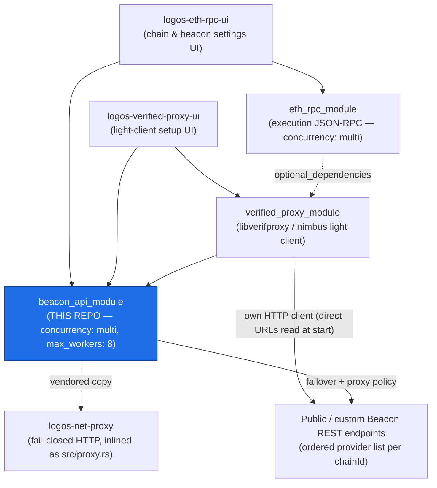
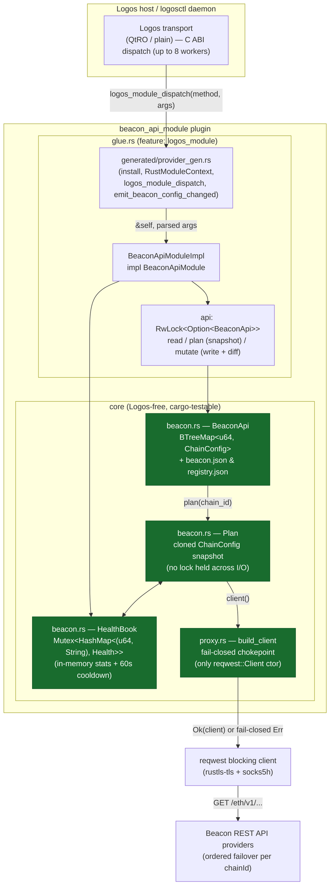

# `beacon_api_module` — Specification & Reference

> Proxyable, fail-closed Ethereum Beacon API client for Logos — the consensus-layer twin of `eth_rpc_module`.
> Per-chain consensus-layer provider lists with failover, staleness checks, and cooldown; `socks5h`/Tor-ready.

This document is the exhaustive reference for **`logos-evm-beacon-api-module`**
(`github.com/logos-co/logos-evm-beacon-api-module`). It is grounded entirely in the
repository source: `metadata.json`, `rust-lib/src/{lib.rs,glue.rs,beacon.rs,proxy.rs,tests.rs}`,
`rust-lib/Cargo.toml`, `flake.nix`, `CMakeLists.txt`, `.github/workflows/{doctests.yml,unit-tests.yml}`,
and the executable doc-test under `doctests/`.

---

## 1. Purpose & place in the system

The Logos Ethereum stack is built as a set of **Logos modules** — process-isolated plugins
that communicate over a Logos transport (QtRO / plain) via a typed RPC bridge. While
[`eth_rpc_module`](https://github.com/logos-co/logos-evm-eth-rpc-module) handles
execution-layer JSON-RPC, **`beacon_api_module`** is its **consensus-layer twin**: the
single device-wide registry and proxyable HTTP client for Ethereum **Beacon REST API**
providers.

Specifically, `beacon_api_module`:

- **Stores ordered per-chain provider lists and transport policy**, keyed by EIP-155
  `chainId` (`1`, `11155111`, `560048`, or any custom chain) and persisted atomically to
  disk (`beacon.json` + `registry.json`). Each provider carries a stable DNS-label `id` and
  a normalized `http(s)` `endpoint`.
- **Serves the four light-client REST routes** (`getLightClientBootstrap`,
  `getLightClientUpdatesByRange`, `getLightClientOptimisticUpdate`,
  `getLightClientFinalityUpdate`) via `lc_request`, plus `finalized_header` (`https`-only),
  `provider_health` (verifying `Eth-Consensus-Version` and slot lag), and `raw_get`
  (`/eth/v1/` or `/eth/v2/` diagnostics).
- **Fails over automatically across enabled providers** on transport errors, non-2xx HTTP
  responses, oversized or non-JSON bodies (such as captive-portal HTML on plain HTTP), or
  head updates more than `64` slots behind the wall clock, demoting repeatedly failing
  providers into a `60 s` cooldown.
- **Builds every outbound HTTP client through a single fail-closed chokepoint**
  (`src/proxy.rs`, an inlined copy of `logos-net-proxy`): a chain configured with
  `proxyRequired: true` and no usable proxy **refuses to send** rather than leaking traffic
  in the clear.
- **Runs concurrently (`concurrency: "multi"`, `max_workers: 8`)** and **never holds its
  config lock across network I/O**: light-client range queries can legitimately run for
  minutes, so each request snapshots its chain config into a `Plan` under a brief read lock
  before touching the network (§9).

### Where it sits in the Logos EVM dependency graph



`beacon_api_module` is a **leaf** of the Logos module graph: it calls **no other Logos
module** (`dependencies: []`). Its only outbound dependency is the network, reached
exclusively through `src/proxy.rs`.

> **Important distinction — `lc_request` callers vs. `verified_proxy_module`:**
> Apps and modules that call `lc_request`, `finalized_header`, `provider_health`, or
> `raw_get` go through `beacon_api_module`'s own HTTP client, sharing its provider list,
> failover, `HealthBook`, and SOCKS/HTTP proxy policy. By contrast, `verified_proxy_module`
> (`libverifproxy`) reads the chain's enabled provider URLs from `beacon_api_module` when
> starting (`init_defaults` + `get_beacon_config`) and fetches from those URLs with **its
> own** internal HTTP client: `beacon_api_module`'s runtime failover and proxy settings do
> **not** apply to `libverifproxy`, changes take effect on `verified_proxy_module`'s next
> start, and `verified_proxy_module` refuses to start on a chain configured with a proxy
> here rather than silently bypassing it.

---

## 2. Module identity (`metadata.json`)

| Field | Value | Meaning |
|-------|-------|---------|
| `name` | `beacon_api_module` | Module id used by `logosctl` / `logoscore` / `lgpm` / callers. |
| `version` | `0.2.0` | Module version. |
| `description` | *Proxyable, fail-closed Ethereum Beacon API client. Per-chain consensus-layer provider lists with failover; serves the light-client routes the verified proxy reads. socks5h/Tor-ready.* | |
| `author` | `Logos Core Team` | |
| `type` | `core` | Headless core service module (no UI). |
| `interface` | `cdylib` | Rust-first module (`Cargo.toml` builds `["staticlib", "rlib"]` linked into the thin CMake plugin wrapper). |
| `concurrency` | `multi` | Opts into concurrent handler dispatch (§9). |
| `max_workers` | `8` | Caps concurrent worker threads for this module in the host. |
| `category` | `wallet` | |
| `main` | `beacon_api_module_plugin` | Built plugin binary name. |
| `dependencies` | `[]` | **No Logos-module dependencies.** |
| `include` / `capabilities` | `[]` | None. |
| `codegen.rust` | `{ crate: "rust-lib", trait: "BeaconApiModule", source: "src/glue.rs" }` | Module builder derives the `.lidl` contract from `BeaconApiModule` (and `BeaconApiModuleEvents`). |
| `nix` | empty `external_libraries` / `packages` / `cmake` | Pure-Rust TLS (`rustls-tls`); no OpenSSL or external system libraries. |

The public API of the module is defined solely by the `BeaconApiModule` and
`BeaconApiModuleEvents` traits in `rust-lib/src/glue.rs` (§5).

---

## 3. Overall architecture

The crate is split into two strict layers:

1. **Logos-free core** (`beacon.rs` + `proxy.rs`, unit-tested in `tests.rs` and
   `proxy::tests`) — plain Rust, zero `unsafe`, zero Logos SDK dependencies, exercised
   offline against local multi-threaded mock servers via `cargo test --no-default-features`.
2. **Logos glue** (`glue.rs`) — compiled only when the default `logos_module` feature is
   enabled. Implements `BeaconApiModule`, holds `RwLock<Option<BeaconApi>>` and
   `HealthBook`, emits `beacon_config_changed` on state diffs, and exposes the generated
   C-ABI dispatch surface.



### Internal pieces

| File | Type / fn | Role |
|------|-----------|------|
| `lib.rs` | crate root | Declares `mod beacon; mod proxy;`, `#[cfg(test)] mod tests;`, and `#[cfg(feature = "logos_module")] mod glue;`. Re-exports public core types and helpers. |
| `beacon.rs` | `BeaconApi` | Persisted `BTreeMap<u64, ChainConfig>` (`beacon.json`) + `BTreeSet<String>` of offered defaults (`registry.json`); config CRUD and `plan()` snapshot builder. |
| `beacon.rs` | `ChainConfig` / `Provider` / `ConfigSource` | Per-chain provider list + proxy/timeout config (`camelCase` serde) and validation. |
| `beacon.rs` | `NETWORKS` / `DEFAULT_PROVIDERS` / `RETIRED_DEFAULTS` | Known network genesis times, probed default providers, and retired default endpoints stripped on load (§5.6). |
| `beacon.rs` | `Plan` | Owned `(chain_id, ChainConfig)` snapshot executing `fetch`, `check_provider`, `finalized_header`, and `raw_get` outside the `RwLock`. |
| `beacon.rs` | `LcRequest` | Typed representation and parser for the 4 Beacon light-client routes, path builder, and per-attempt timeout calculator. |
| `beacon.rs` | `HealthBook` / `Health` | Thread-safe in-memory per-`(chain_id, provider_id)` counters, latency/error tracking, and 3-strike / 60 s cooldown state. |
| `beacon.rs` | `BeaconError` / `Attempt` | Structured error enum with machine-readable `.code()` tokens and per-provider failure trail. |
| `proxy.rs` | `ProxyConfig` / `ProxyError` / `build_client` | **The only** `reqwest::blocking::Client` constructor in the crate; enforces scheme allowlist and fail-closed `proxyRequired`. |
| `glue.rs` | `BeaconApiModule` / `BeaconApiModuleEvents` | Public trait contract (13 methods + `on_context_ready` hook + 1 event). |
| `glue.rs` | `BeaconApiModuleImpl` | Holds `api: RwLock<Option<BeaconApi>>` and `health: HealthBook`; implements `read`, `plan`, and diffed `mutate` helpers. |
| `glue.rs` | `logos_module_install` | `#[no_mangle]` install entry point → `install::<BeaconApiModuleImpl>()`. |
| `tests.rs` | core test suite | 26 unit & local-HTTP integration tests covering parsing, persistence, retired defaults, failover, staleness, cooldown, `Eth-Consensus-Version`, HTTPS-only finalized roots, and single-client-constructor enforcement. |
| *generated* | `generated/provider_gen.rs` | `include!`d by `glue.rs`; generated at Nix build time from `BeaconApiModule` / `BeaconApiModuleEvents` in **multi** mode (`max_workers: 8`). Not checked in (`.gitignore` excludes `rust-lib/generated/`). |

---

## 4. Communication & data flow

`beacon_api_module` calls no other Logos module; callers drive its trait methods over the
Logos transport, and network methods fan out across configured Beacon REST providers
through the fail-closed `reqwest` client.

```mermaid
sequenceDiagram
    autonumber
    participant Caller as eth_rpc_ui / verified_proxy / logosctl
    participant Glue as glue.rs (BeaconApiModuleImpl, &self)
    participant Lock as RwLock&lt;Option&lt;BeaconApi&gt;&gt;
    participant HB as HealthBook (Mutex)
    participant Proxy as proxy.rs build_client
    participant P1 as Provider 1 (pinned or primary)
    participant P2 as Provider 2 (fallback)

    Note over Caller,Lock: Write path — brief WRITE lock + atomic persist + post-lock event
    Caller->>Glue: init_defaults() / add_provider(...)
    Glue->>Lock: write() → mutate + atomic write_json(beacon.json)
    Lock-->>Glue: guard dropped (changed = true)
    Glue-->>Caller: emit beacon_config_changed(chain_id) + {"ok":true,...}

    Note over Caller,P2: Read + failover path — brief READ lock, zero lock held during HTTP I/O
    Caller->>Glue: lc_request(1, "getLightClientOptimisticUpdate", "{}", "", 0)
    Glue->>Lock: read() → api.plan(1) clones ChainConfig
    Lock-->>Glue: guard dropped immediately → Plan
    Glue->>Proxy: build_client(ProxyConfig)
    alt proxyRequired && no usable proxy
        Proxy-->>Glue: Err(ProxyRequiredButUnset) ❌ fail-closed
        Glue-->>Caller: {"ok":false,"code":"proxy","error":"proxy required..."}
    else proxy OK (or not required)
        Proxy-->>Glue: reqwest::blocking::Client
        Glue->>HB: order(pinned=None) → [P1, P2] (cooling providers sorted last)
        Glue->>P1: GET /eth/v1/beacon/light_client/optimistic_update
        P1-->>Glue: HTTP 503 (or stale slot > 64 behind clock)
        Glue->>HB: record(1, P1.id, Err("HTTP 503"))
        Glue->>P2: GET /eth/v1/beacon/light_client/optimistic_update
        P2-->>Glue: HTTP 200 + fresh JSON update
        Glue->>HB: record(1, P2.id, Ok(latency))
        Glue-->>Caller: {"ok":true,"provider":P2.id,"body":"{...}","attempts":[{"provider":P1.id,"error":"HTTP 503"}]}
    end
```

### How specific callers drive it

- **`eth_rpc_ui` (`logos-eth-rpc-ui`)** calls `init_defaults()` on start, subscribes to
  `beacon_config_changed`, reads `get_beacon_config(chainId)` and `list_providers(chainId)`
  for the selected chain, mutates providers and proxy policy via `add_provider`,
  `set_provider_enabled`, `remove_provider`, and `set_beacon_config`, and runs on-demand
  provider diagnostics via `provider_health(chainId, id)`.
- **`verified_proxy_module` (`logos-verified-proxy-module`)** calls `init_defaults()` and
  `get_beacon_config(chainId)` when starting its light client (`beaconSource: "module"`),
  extracting the ordered list of enabled provider URLs (and refusing to start if `proxy` or
  `proxyRequired` is set on the chain, since `libverifproxy` uses its own HTTP stack).
- **`verified_proxy_ui` (`logos-verified-proxy-ui`)** calls `init_defaults()` and
  `finalized_header(chainId)` asynchronously to pre-fill a recent finalized block root
  (`https` providers only) for the user to inspect when bootstrapping the light client.

---

## 5. Full API reference (`BeaconApiModule`)

The public contract is the `BeaconApiModule` trait in `rust-lib/src/glue.rs`. Every method
returns a **JSON string** (`String`) — unlike `eth_rpc_module`, no method returns a bare
`bool`.

```jsonc
// success
{ "ok": true, ...payload... }

// structured BeaconError refusal
{ "ok": false, "code": "<token>", "error": "<message>" }
// (when code is "unavailable" or "timeout", also carries "attempts": [{ "provider", "error" }, ...])

// config / provider validation refusal (set_beacon_config, add_provider)
{ "ok": false, "code": "bad_config", "error": "<message>" }

// module context not yet initialized (before on_context_ready)
{ "ok": false, "state": "unready", "code": "unready", "error": "beacon_api not initialized (context not ready)" }

// malformed caller JSON, negative chain_id, or poisoned lock
{ "ok": false, "error": "<message>" }
```

Parameter types use LIDL primitives: `chain_id` and `deadline_ms` are `i64`; JSON payloads,
provider ids, route names, and paths are `String`; `enabled` is `bool`. Every `chain_id`
is validated via `u64::try_from(chain_id)` — negative values fail immediately with
`{ "ok": false, "error": "chain id must be positive, got <chain_id>" }`.

> **Calling convention via `logosctl`:**
> `logosctl call beacon_api_module <method> <args...>`. When passing a JSON object inline as
> a string parameter, prefix it with `str:` (e.g.
> `'str:{"endpoint":"https://beacon.example.org"}'`) or pass `@file.json` so `logosctl`
> forwards a JSON string rather than parsing it as a non-string value.

### 5.1 Initialization & configuration methods

#### `init_defaults() -> String`
Seed [`DEFAULT_PROVIDERS`](#the-built-in-providers-default_providers-beaconrs) per provider,
only where absent and at most once per device (§5.6). Performs no network I/O.
- **Success:** `{ "ok": true, "applied": <bool>, "seeded": { "<chainId>": ["<providerId>", ...] } }`.
  Only chains that actually gained at least one provider appear in `seeded`; `applied` is
  `true` iff `seeded` is non-empty.
- **Side effects:** Persists `beacon.json` (if `seeded` is non-empty) and `registry.json`
  (recording all `DEFAULT_PROVIDERS` keys in `offeredDefaults`), then emits
  `beacon_config_changed(chainId)` for each chain in `seeded`.
- **Error:** `unready` envelope if context is not ready.
- **Lock:** WRITE.

```bash
logosctl call beacon_api_module init_defaults
# -> {"applied":true,"ok":true,"seeded":{"1":["lodestar","nimbus-testing","nimbus-unstable"],"11155111":["lodestar","nimbus-unstable"],"560048":["lodestar","nimbus-testing"]}}
```

#### `config_status() -> String`
Report whether any chain configuration exists, with per-chain provider counts. Performs no
network I/O.
- **Success:**
  ```json
  {
    "ok": true,
    "state": "configured",
    "chains": [
      { "chainId": 1, "network": "mainnet", "providers": 3, "enabled": 3 }
    ]
  }
  ```
  `state` is `"unconfigured"` when `chains` is empty, `"configured"` otherwise. `network`
  is `"mainnet"`, `"sepolia"`, `"hoodi"`, or `null` for unknown chain ids. Chains are
  ordered ascending by `chainId` (`BTreeMap`).
- **Error:** `unready` envelope if context is not ready.
- **Lock:** READ.

#### `get_beacon_config(chain_id: i64) -> String`
Return the stored `ChainConfig` for `chain_id`.
- **Success:** `{ "ok": true, "chainId": <u64>, "config": { "providers": [...], "proxy"?: "...", "proxyRequired": <bool>, "timeoutSecs": <u64> } }`.
  (`proxy` is omitted when `None`.)
- **Error:** `{ "ok": false, "code": "unknown_chain", "error": "no beacon configuration for chain <id>" }`, or `unready`.
- **Lock:** READ.

#### `set_beacon_config(chain_id: i64, config_json: String) -> String`
Patch a chain's transport settings and optionally replace its provider list. Creates the
chain with defaults first if absent.
- **`config_json`** — JSON object supporting:
  - `"proxy"`: `string | null` — trimmed; `null` or `""` clears `proxy`; omitted preserves stored `proxy`. Validated against `{socks5h, socks5, http, https}`.
  - `"proxyRequired"`: `bool` — omitted preserves stored value (default `false`).
  - `"timeoutSecs"`: `u64` in `1..=120` — omitted preserves stored value (default `15`).
  - `"providers"`: `[{ "endpoint": "...", "id"?: "...", "enabled"?: bool }, ...]` — when
    present, **replaces** the chain's provider list (every entry receives
    `source: "external"`, normalized endpoint, and derived `id` if omitted); when omitted,
    preserves the existing provider list.
- **Validation is atomic:** if any field or provider fails `ChainConfig::validate()` (§6.1),
  nothing in memory or on disk is modified.
- **Success:** `{ "ok": true, "chainId": <u64>, "config": <ChainConfig> }`.
- **Error:** `{ "ok": false, "code": "bad_config", "error": "<detail>" }` on validation
  failure; `{ "ok": false, "error": "<serde error>" }` if `config_json` is not valid JSON;
  or `unready`.
- **Lock:** WRITE (emits `beacon_config_changed(chain_id)` iff the stored record changed).

#### `remove_beacon_config(chain_id: i64) -> String`
Remove the entire `ChainConfig` for `chain_id` and persist `beacon.json`. Default providers
previously offered on that chain remain in `registry.json` (`offeredDefaults`), so a later
`init_defaults()` will not re-add them.
- **Success:** `{ "ok": true, "removed": <bool> }` (`true` if a record existed, `false`
  otherwise).
- **Lock:** WRITE (emits `beacon_config_changed(chain_id)` iff `removed` is `true`).

### 5.2 Provider management & health methods

#### `list_providers(chain_id: i64) -> String`
List a chain's configured providers paired with their live in-memory `Health` counters
(§6.2). Performs no network I/O.
- **Success:**
  ```json
  {
    "ok": true,
    "chainId": 11155111,
    "network": "sepolia",
    "providers": [
      {
        "id": "lodestar",
        "endpoint": "https://lodestar-sepolia.chainsafe.io",
        "enabled": true,
        "source": "default",
        "https": true,
        "health": {
          "served": 1,
          "failures": 0,
          "consecutiveFailures": 0,
          "lastOkAt": 1762190000,
          "lastError": "",
          "lastErrorAt": 0,
          "lastLatencyMs": 184
        }
      }
    ]
  }
  ```
- **Error:** `unknown_chain` if `chain_id` has no configuration, or `unready`.
- **Lock:** READ (`BeaconApi`) + brief `Mutex` lock per provider (`HealthBook`).

#### `add_provider(chain_id: i64, provider_json: String) -> String`
Append a provider to `chain_id` (creating the chain with default transport settings if
absent) and persist.
- **`provider_json`** — `{ "endpoint": "https://...", "id"?: "my-node", "enabled"?: true }`.
  - `endpoint` (required): normalized via `normalize_endpoint` (trimmed, trailing `/`
    removed, `http` or `https`, non-empty host, no query or fragment).
  - `id` (optional): if omitted or blank, derived automatically from the URL host via
    `derive_id` (e.g. `https://beacon.example.org/rest/` → `"beacon-example-org"`, or
    `"beacon-example-org-2"` on collision). If supplied, must satisfy `valid_id` (§6.1) and
    be unique on the chain.
  - `enabled` (optional): defaults to `true` when omitted or `null`.
  - Any `"source"` key supplied by the caller is ignored; `source` is always `"external"`.
- **Success:** `{ "ok": true, "chainId": <u64>, "provider": { "id", "endpoint", "enabled", "source": "external" } }`.
- **Error:** `{ "ok": false, "code": "bad_config", "error": "<detail>" }` (e.g. duplicate
  endpoint/id, invalid scheme/id), JSON parse error, or `unready`.
- **Lock:** WRITE (emits `beacon_config_changed(chain_id)`).

```bash
logosctl call beacon_api_module add_provider 11155111 'str:{"endpoint":"https://beacon.example.org"}'
# -> {"chainId":11155111,"ok":true,"provider":{"enabled":true,"endpoint":"https://beacon.example.org","id":"beacon-example-org","source":"external"}}
```

#### `remove_provider(chain_id: i64, provider_id: String) -> String`
Remove one provider by `id` from `chain_id`, persist `beacon.json`, and purge its in-memory
entry from `HealthBook`.
- **Success:** `{ "ok": true, "chainId": <u64>, "removed": "<provider_id>" }`.
- **Error:** `unknown_chain` or `unknown_provider` (`chain <id> has no provider '<id>'`).
- **Lock:** WRITE (emits `beacon_config_changed(chain_id)`).

#### `set_provider_enabled(chain_id: i64, provider_id: String, enabled: bool) -> String`
Enable or disable one provider on `chain_id` without removing it.
- **Success:** `{ "ok": true, "chainId": <u64>, "provider": "<provider_id>", "enabled": <bool> }`.
- **Error:** `unknown_chain` or `unknown_provider`.
- **Lock:** WRITE (persists and emits `beacon_config_changed(chain_id)` only when `enabled`
  actually changed).

#### `provider_health(chain_id: i64, provider_id: String) -> String`
Perform a live, **non-failover** probe against a single configured provider (enabled or
disabled) by issuing `GET /eth/v1/beacon/light_client/optimistic_update` through the
chain's fail-closed HTTP client and updating `HealthBook`.

A provider is considered `healthy: true` **only** if:
1. It responds HTTP 2xx within `timeoutSecs` with a valid light-client update JSON carrying
   a slot (`data.signature_slot` or `data.attested_header.beacon.slot`), **and**
2. It includes a non-empty **`Eth-Consensus-Version`** response header (which nimbus's
   light client requires to select the consensus fork decoder), **and**
3. On known networks (`1`, `11155111`, `560048`), its slot lag is `<= 64` slots
   (`MAX_HEAD_LAG_SLOTS`).

- **Success (`ok: true` — probe completed, even if the provider itself is unhealthy):**
  - Healthy / stale (`Eth-Consensus-Version` present + valid slot):
    ```json
    {
      "ok": true,
      "chainId": 11155111,
      "provider": "lodestar",
      "endpoint": "https://lodestar-sepolia.chainsafe.io",
      "https": true,
      "latencyMs": 210,
      "servesLightClient": true,
      "consensusVersion": "fulu",
      "slot": 9123456,
      "lagSlots": 1,
      "healthy": true
    }
    ```
    (If `lagSlots > 64`, `healthy` is `false` and `"error": "<N> slots behind the clock"` is
    added. On custom chains not in `NETWORKS`, `lagSlots` is `null` and staleness is not
    flagged.)
  - Missing `Eth-Consensus-Version` header: `servesLightClient: false`, `healthy: false`,
    `error: "no Eth-Consensus-Version header, which the verified proxy's light client needs"`.
  - Non-update 200 body: `servesLightClient: false`, `healthy: false`,
    `error: "answered, but not with a light-client update"`.
  - HTTP / transport failure: `servesLightClient: false`, `healthy: false`,
    `error: "HTTP <code>"` or `"timeout after <ms>ms"` / OS cause chain.
- **Error (`ok: false` — probe could not be initiated):** `unknown_chain`,
  `unknown_provider`, `proxy` (fail-closed proxy error), or `unready`.
- **Lock:** Brief READ to clone `Plan`; **no lock held during HTTP I/O**; updates
  `HealthBook` afterward.

### 5.3 Light-client & diagnostic HTTP methods

#### `lc_request(chain_id: i64, endpoint: String, params_json: String, provider: String, deadline_ms: i64) -> String`
Execute one Ethereum Beacon light-client REST request with automatic failover across the
chain's enabled providers.

- **`endpoint` & `params_json`** — named identically to `libverifproxy`'s beacon transport:

  | `endpoint` | Required `params_json` fields | Beacon REST path (`GET`) | Per-attempt timeout |
  |------------|-------------------------------|--------------------------|---------------------|
  | `getLightClientBootstrap` | `{ "block_root": "<64 hex chars, with or without 0x>" }` (normalized to lowercase `0x…`) | `/eth/v1/beacon/light_client/bootstrap/0x<root>` | `timeoutSecs` |
  | `getLightClientUpdatesByRange` | `{ "start_period": <u64\|str>, "count": <1..=128\|str> }` | `/eth/v1/beacon/light_client/updates?start_period=<p>&count=<c>` | `timeoutSecs + 2 * count` |
  | `getLightClientOptimisticUpdate` | `{}` or `""` | `/eth/v1/beacon/light_client/optimistic_update` | `timeoutSecs` |
  | `getLightClientFinalityUpdate` | `{}` or `""` | `/eth/v1/beacon/light_client/finality_update` | `timeoutSecs` |

- **`provider`** — optional provider `id` to try first (`""` = unpinned). If `provider`
  names an enabled provider on the chain, it is tried first and remaining enabled providers
  follow on failure; if empty, disabled, or unknown, enabled providers are tried in default
  failover order (§6.2).
- **`deadline_ms`** — wall-clock budget for the **entire failover** across providers:
  `<= 0` uses `DEFAULT_DEADLINE` (`30_000 ms`); positive values are capped at `MAX_DEADLINE`
  (`600_000 ms`). Each attempt's timeout is `min(attempt_timeout, remaining_deadline)`. If
  less than `MIN_ATTEMPT` (`50 ms`) remains before trying a provider, failover aborts with
  `code: "timeout"`.
- **Success:** `{ "ok": true, "provider": "<winning_id>", "body": "<raw JSON string>", "attempts": [{ "provider": "<failed_id>", "error": "<why>" }, ...] }`.
  `body` is the winning provider's HTTP response body **verbatim** (not re-serialized), and
  `attempts` lists any prior providers that failed before the winner succeeded.
- **Error:** `bad_request` (invalid `params_json`, unknown `endpoint`, bad `block_root`, or
  `count` outside `1..=128`), `unknown_chain`, `no_providers` (zero enabled providers),
  `proxy` (fail-closed), `timeout` (deadline exhausted), `unavailable` (every enabled
  provider failed within the deadline), or `unready`.
- **Lock:** Brief READ to clone `Plan`; **no lock held during HTTP I/O**; records each
  attempt in `HealthBook`.

```bash
logosctl call beacon_api_module lc_request 11155111 getLightClientOptimisticUpdate '{}' '' 0
# -> {"attempts":[],"body":"{\"version\":\"fulu\",\"data\":{...}}","ok":true,"provider":"lodestar"}
```

#### `finalized_header(chain_id: i64) -> String`
Fetch the current finalized beacon block header (`GET /eth/v1/beacon/headers/finalized`)
from **enabled `https://` providers only**, failing over across them in `Plan::order`
(cooling providers last). Plain `http://` providers are skipped unconditionally so an
on-path attacker cannot swap the checkpoint root over cleartext (§7.2).

- **Success:** `{ "ok": true, "chainId": <u64>, "root": "0x<64-hex>", "slot": "<decimal>", "provider": "<id>", "endpoint": "https://..." }`.
- **Error:** `unknown_chain`, `no_providers` (no enabled `https://` providers on the chain),
  `proxy`, `unavailable` (all `https://` providers failed or returned a payload without a
  66-char `0x`-prefixed `/data/root` and `/data/header/message/slot`), or `unready`.
- **Lock:** Brief READ to clone `Plan`; **no lock held during HTTP I/O** (reads
  `HealthBook` for ordering, does not mutate `HealthBook`).

#### `raw_get(chain_id: i64, path: String, provider: String) -> String`
Perform a diagnostic `GET` under `/eth/v1/` or `/eth/v2/` (for example
`/eth/v1/beacon/genesis`).

- **`path`** — must start with `"/eth/v1/"` or `"/eth/v2/"` and must **not** contain `".."`,
  otherwise refused with `code: "bad_request"`.
- **`provider`** — unlike `lc_request`, pinning is **strict** here:
  - Non-empty `provider`: looks up that exact `id` on the chain (even if disabled; returns
    `unknown_provider` if absent) and tries **only** that provider with **no failover**.
  - Empty `""`: fails over across enabled providers in `Plan::order`.
- **Success:** `{ "ok": true, "provider": "<id>", "result": <parsed JSON | raw string> }`.
- **Error:** `bad_request`, `unknown_chain`, `unknown_provider`, `no_providers`, `proxy`,
  `unavailable`, or `unready`.
- **Lock:** Brief READ to clone `Plan`; **no lock held during HTTP I/O**.

### 5.4 Lifecycle hook (not externally callable)

#### `on_context_ready(&self, ctx: &RustModuleContext)`
Invoked once by the host before the first inbound call. Initializes the persisted store:

```rust
let path = std::path::Path::new(&ctx.instance_persistence_path).join("beacon.json");
*self.api.write().unwrap() = Some(BeaconApi::with_store(path));
```

`BeaconApi::with_store` loads `beacon.json`, strips any builtin [`RETIRED_DEFAULTS`](#retired-defaults-retired_defaults)
entries (persisting immediately if any were removed), and loads `offeredDefaults` from
sibling `registry.json`. Before `on_context_ready` runs, every method returns the `unready`
envelope.

### 5.5 Return-shape & lock summary

| Method | Lock | Network I/O | Success shape |
|--------|------|-------------|---------------|
| `init_defaults` | W | No | `{ ok, applied, seeded:{ "<chainId>":[id,…] } }` |
| `config_status` | R | No | `{ ok, state, chains:[{ chainId, network, providers, enabled }] }` |
| `get_beacon_config` | R | No | `{ ok, chainId, config }` |
| `set_beacon_config` | W | No | `{ ok, chainId, config }` |
| `remove_beacon_config` | W | No | `{ ok, removed:bool }` |
| `list_providers` | R | No | `{ ok, chainId, network, providers:[{ id, endpoint, enabled, source, https, health }] }` |
| `add_provider` | W | No | `{ ok, chainId, provider }` |
| `remove_provider` | W | No | `{ ok, chainId, removed:id }` |
| `set_provider_enabled` | W | No | `{ ok, chainId, provider:id, enabled }` |
| `provider_health` | R (snapshot) | Yes (1 provider) | `{ ok, chainId, provider, endpoint, https, latencyMs, servesLightClient, healthy, consensusVersion?, slot?, lagSlots?, error? }` |
| `lc_request` | R (snapshot) | Yes (failover) | `{ ok, provider, body, attempts }` |
| `finalized_header` | R (snapshot) | Yes (HTTPS failover) | `{ ok, chainId, root, slot, provider, endpoint }` |
| `raw_get` | R (snapshot) | Yes (pinned or failover) | `{ ok, provider, result }` |

### 5.6 Initialization convention, defaults & retired defaults

Like `eth_rpc_module`, `beacon_api_module` ships working defaults so the light client and UI
work out of the box, but **never seeds itself automatically**: consumers (`eth_rpc_ui`,
`verified_proxy_module`, `verified_proxy_ui`) call `init_defaults()` unconditionally on
startup.

#### Known networks (`NETWORKS`, `beacon.rs`)

| Chain | `chain_id` | `name` | `genesis_time` (Unix s) | Slot time |
|-------|-----------:|--------|------------------------:|----------:|
| Ethereum Mainnet | `1` | `"mainnet"` | `1_606_824_023` | `12 s` |
| Sepolia | `11155111` | `"sepolia"` | `1_655_733_600` | `12 s` |
| Hoodi | `560048` | `"hoodi"` | `1_742_213_400` | `12 s` |

Custom `chain_id`s outside `NETWORKS` are fully supported (`network` reports `null` and
wall-clock slot-lag checks are skipped because no genesis timestamp is known).

#### The built-in providers (`DEFAULT_PROVIDERS`, `beacon.rs`)

Probed live 2026-11-03; every entry serves all four light-client routes **and** sends the
`Eth-Consensus-Version` response header:

| Chain (`chain_id`) | `id` | `endpoint` | Scheme / role |
|--------------------|------|------------|---------------|
| `1` (mainnet) | `lodestar` | `https://lodestar-mainnet.chainsafe.io` | HTTPS primary (eligible for `finalized_header`) |
| `1` (mainnet) | `nimbus-testing` | `http://testing.mainnet.beacon-api.nimbus.team` | Plain-HTTP fallback (`lc_request` only) |
| `1` (mainnet) | `nimbus-unstable` | `http://unstable.mainnet.beacon-api.nimbus.team` | Plain-HTTP fallback (`lc_request` only) |
| `11155111` (sepolia) | `lodestar` | `https://lodestar-sepolia.chainsafe.io` | HTTPS primary (eligible for `finalized_header`) |
| `11155111` (sepolia) | `nimbus-unstable` | `http://unstable.sepolia.beacon-api.nimbus.team` | Plain-HTTP fallback (`lc_request` only) |
| `560048` (hoodi) | `lodestar` | `https://lodestar-hoodi.chainsafe.io` | HTTPS primary (eligible for `finalized_header`) |
| `560048` (hoodi) | `nimbus-testing` | `http://testing.hoodi.beacon-api.nimbus.team` | Plain-HTTP fallback (`lc_request` only) |

**Seeding invariants:**
- **Seeded at most once per `(chainId, id)` per device:** `registry.json` persists every
  offered `<chainId>/<id>` key in `offeredDefaults`. Removing a default provider via
  `remove_provider` (or removing its chain via `remove_beacon_config`) keeps it removed
  across restarts and subsequent `init_defaults()` calls.
- **Never clobbers caller entries:** if a chain already has a provider with the same `id`
  **or** the same normalized `endpoint` (e.g. added by a user under `"id": "mine"`),
  `init_defaults()` skips that default and still seeds any non-clashing defaults.
- **Caller writes cannot claim `source: "default"`:** `provider_from_caller` unconditionally
  stamps `ConfigSource::External`, so `source: "default"` exclusively identifies untouched
  entries seeded by `init_defaults()`.

#### Retired defaults (`RETIRED_DEFAULTS`, `beacon.rs`)

| `chain_id` | Retired endpoint | Reason |
|-----------:|------------------|--------|
| `1` | `https://ethereum-beacon-api.publicnode.com` | Sends no `Eth-Consensus-Version` header, so nimbus's light client cannot decode its updates. |
| `560048` | `https://ethereum-hoodi-beacon-api.publicnode.com` | Same (`Eth-Consensus-Version` absent). |

On `BeaconApi::load()`, `drop_retired_defaults()` removes any provider matching
`(chain_id, endpoint)` **iff `p.source == ConfigSource::Builtin`**, immediately rewriting
`beacon.json`. If a user explicitly added the same URL (`source == ConfigSource::External`),
their entry is preserved untouched.

### 5.7 Events (`BeaconApiModuleEvents`)

Declared via `pub trait BeaconApiModuleEvents` in `src/glue.rs`:

| Event | Payload | When emitted |
|-------|---------|--------------|
| `beacon_config_changed` | `chain_id: i64` | That chain's persisted `ChainConfig` was created, modified, or removed. |

**Emission invariants:**
1. **Emit only on an actual change:** `mutate` snapshots `before = api.chain(id).cloned()`
   inside the write lock and compares `before.as_ref() != api.chain(id)` after the closure
   runs. No-op writes (e.g. `set_provider_enabled` to the current state, `remove_beacon_config`
   on an absent chain, or a rejected `bad_config`) emit nothing. `init_defaults` emits once
   per chain that actually gained at least one provider; a second `init_defaults` emits
   nothing.
2. **Durable state before event:** Both `beacon.json` persistence and write-lock release
   complete **before** `emit_beacon_config_changed(chain_id)` is called, so any subscriber
   immediately calling `get_beacon_config` or `list_providers` observes the new state.
3. **Reads and probes are silent:** `config_status`, `get_beacon_config`, `list_providers`,
   `provider_health`, `lc_request`, `finalized_header`, and `raw_get` never emit events
   (in-memory `HealthBook` updates do not trigger `beacon_config_changed`).

---

## 6. Configuration, failover & data model

### 6.1 `ChainConfig` & `Provider` (`beacon.rs`)

```rust
#[derive(Clone, Debug, PartialEq, Eq, Serialize, Deserialize)]
#[serde(rename_all = "camelCase")]
pub struct Provider {
    pub id: String,               // 1..=40 chars of [a-z0-9-], no leading/trailing '-'
    pub endpoint: String,         // normalized http(s)://host[/path], no trailing '/'
    #[serde(default = "default_true")]
    pub enabled: bool,            // default true
    #[serde(default)]
    pub source: ConfigSource,     // "external" (default on read) | "default"
}

#[derive(Clone, Debug, PartialEq, Eq, Serialize, Deserialize)]
#[serde(rename_all = "camelCase")]
pub struct ChainConfig {
    #[serde(default)]
    pub providers: Vec<Provider>,
    #[serde(default, skip_serializing_if = "Option::is_none")]
    pub proxy: Option<String>,    // e.g. "socks5h://127.0.0.1:9050"
    #[serde(default)]
    pub proxy_required: bool,     // JSON: "proxyRequired" — fail-closed switch
    #[serde(default = "default_timeout")]
    pub timeout_secs: u64,        // JSON: "timeoutSecs" — default 15, validated 1..=120
}
```

**Validation rules (`ChainConfig::validate`):**
- `timeoutSecs` must be in **`1..=120`** (default `15`). Note: `ChainConfig::proxy_config()`
  passes `timeout_secs: 0` to `build_client` so each request sets its own exact timeout via
  `RequestBuilder::timeout(...)` (`timeoutSecs` for standard calls, or
  `timeoutSecs + 2 * count` for `getLightClientUpdatesByRange`, bounded by the remaining
  failover deadline).
- `proxy`, when present and non-empty, must parse as a URL with scheme in
  `{socks5h, socks5, http, https}`.
- Every provider `id` must satisfy `valid_id`: length `1..=40`, ASCII lowercase letters,
  digits, or `'-'`, neither starting nor ending with `'-'`. When omitted on `add_provider`
  or `set_beacon_config`, `derive_id` lowercases the URL host, maps non-alphanumerics to
  `'-'`, truncates to 36 chars, trims `'-'` (falling back to `"provider"`), and appends
  `-2`, `-3`, … on collision.
- Every provider `endpoint` must equal `normalize_endpoint(&p.endpoint)`: `http` or `https`,
  non-empty host, no `?query` or `#fragment`, trimmed, and trailing `/` stripped (subpaths
  such as `https://beacon.example.org/rest` are preserved).
- No duplicate `id`s and no duplicate normalized `endpoint`s within the same chain.

### 6.2 Failover, staleness & `HealthBook`

| Constant | Value | Role |
|----------|-------|------|
| `MAX_BODY` | `32 MiB` (`33_554_432 B`) | Response body cap (`resp.take(MAX_BODY + 1)`); 128 updates measured ~7.3 MiB. |
| `MAX_HEAD_LAG_SLOTS` | `64` slots (`~12.8 min`) | Max tolerated lag on optimistic/finality head updates (`SLOT_SECS = 12`). |
| `SECS_PER_UPDATE` | `2 s` | Extra per-update timeout allowance for `getLightClientUpdatesByRange` (`count` up to `128`). |
| `MIN_ATTEMPT` | `50 ms` | Minimum remaining deadline required to start another provider attempt. |
| `DEFAULT_DEADLINE` | `30 s` | Total failover deadline when caller passes `deadline_ms <= 0`. |
| `MAX_DEADLINE` | `600 s` (`10 min`) | Upper cap on caller-supplied `deadline_ms`. |
| `COOLDOWN_AFTER` | `3` | Consecutive failures before a provider enters cooldown. |
| `COOLDOWN` | `60 s` | Duration a cooling provider is demoted to the back of `Plan::order`. |

**Provider ordering (`Plan::order`):**
1. Disabled providers (`enabled: false`) are excluded.
2. If `pinned` matches an enabled provider's `id`, that provider is placed **first** (even if
   currently cooling).
3. Remaining enabled providers keep their relative configured order, stably partitioned so
   non-cooling providers come **before** cooling providers (`cooling_until > Instant::now()`).

**Per-attempt validation (`Plan::check` in `lc_request`):**
1. HTTP status must be 2xx (`status.is_success()`), and body must be `<= 32 MiB`.
2. Trimmed body must start with `{` or `[` — catches HTTP 200 HTML pages from captive Wi-Fi
   portals on plain-HTTP fallback providers.
3. For head routes (`Optimistic` and `Finality`), the JSON must parse, carry a slot at
   `/data/signature_slot` or `/data/attested_header/beacon/slot`, and — on chains in
   `NETWORKS` — satisfy `lag_slots(chain_id, slot, unix_now()) <= 64`.

**`HealthBook` tracking:**
- In-memory only (`Mutex<HashMap<(u64, String), Health>>`), reset on daemon restart and
  per-provider on `remove_provider`.
- Updated by `lc_request` (each provider attempt) and `provider_health` (single probe).
- Success increments `served`, zeroes `consecutiveFailures`, clears `cooling_until`, and
  records `lastOkAt` (Unix seconds) and `lastLatencyMs`.
- Failure increments `failures` and `consecutiveFailures`, records `lastError` and
  `lastErrorAt`, and arms `cooling_until = Instant::now() + 60s` once
  `consecutiveFailures >= 3`.

### 6.3 `BeaconError` (`beacon.rs`) and machine error codes

| Source / Variant | `code` | `Display` (`error` field) | Extra fields |
|------------------|--------|---------------------------|--------------|
| `unready()` (`glue.rs`) | `"unready"` | `beacon_api not initialized (context not ready)` | `"state": "unready"` |
| Config validation (`glue.rs`) | `"bad_config"` | Validation detail (e.g. `timeoutSecs must be 1..=120, got 0`) | — |
| `BeaconError::UnknownChain(id)` | `"unknown_chain"` | `no beacon configuration for chain <id>` | — |
| `BeaconError::NoProviders(id)` | `"no_providers"` | `chain <id> has no enabled beacon provider` | — |
| `BeaconError::UnknownProvider { chain_id, id }` | `"unknown_provider"` | `chain <chain_id> has no provider '<id>'` | — |
| `BeaconError::BadRequest(msg)` | `"bad_request"` | `<msg>` (bad `lc_request` params/endpoint or invalid `raw_get` path) | — |
| `BeaconError::Proxy(msg)` | `"proxy"` | `<ProxyError Display>` | — |
| `BeaconError::AllFailed { attempts, deadline: true }` | `"timeout"` | `every provider failed: <id>: <err>; ...` | `"attempts": [...]` |
| `BeaconError::AllFailed { attempts, deadline: false }` | `"unavailable"` | `every provider failed: <id>: <err>; ...` | `"attempts": [...]` |

HTTP transport errors walk `std::error::Error::source()` (`describe` in `beacon.rs`) so OS
connection reasons are preserved, while request/body timeouts format deterministically as
`"timeout after <ms>ms"`.

### 6.4 `ProxyConfig` / `ProxyError` (`proxy.rs`)

| `ProxyError` | Message |
|--------------|---------|
| `ProxyRequiredButUnset` | `proxy required but none configured (fail-closed: refusing to send in the clear)` |
| `ProxyUnusable(s)` | `proxy URL is invalid or unsupported: <s>` |
| `Build(s)` | `failed to build HTTP client: <s>` |

### 6.5 Persisted state — `beacon.json` and `registry.json`

Both files live in `<instance_persistence_path>/` and are written **atomically** via
`write_json` (pretty-printed to `<name>.json.tmp`, then `std::fs::rename`d into place so a
crash mid-write never leaves a truncated JSON file):

1. **`beacon.json`** — stringified `chainId` → `ChainConfig` (`BTreeMap` for deterministic
   key order):
   ```json
   {
     "1": {
       "providers": [
         { "id": "lodestar", "endpoint": "https://lodestar-mainnet.chainsafe.io", "enabled": true, "source": "default" }
       ],
       "proxyRequired": false,
       "timeoutSecs": 15
     },
     "11155111": {
       "providers": [
         { "id": "lodestar", "endpoint": "https://lodestar-sepolia.chainsafe.io", "enabled": true, "source": "default" }
       ],
       "proxy": "socks5h://127.0.0.1:9050",
       "proxyRequired": true,
       "timeoutSecs": 15
     }
   }
   ```
   Non-numeric top-level keys are ignored on load.

2. **`registry.json`** — tracks every built-in provider ever offered on this device:
   ```json
   {
     "offeredDefaults": [
       "1/lodestar",
       "1/nimbus-testing",
       "1/nimbus-unstable",
       "11155111/lodestar",
       "11155111/nimbus-unstable",
       "560048/lodestar",
       "560048/nimbus-testing"
     ]
   }
   ```
   Written *after* `beacon.json` during `init_defaults()`, ensuring a crash before
   `beacon.json` lands cannot mark unseeded defaults as already offered.

---

## 7. Fail-closed proxy chokepoint & trust model

### 7.1 Fail-closed HTTP chokepoint (`src/proxy.rs`)

`src/proxy.rs::build_client` is **the sole constructor of a `reqwest::blocking::Client` in
the crate**, enforced by the source-scanning unit test `only_proxy_rs_builds_a_client` in
`src/tests.rs` (which reads every `.rs` file in `src/` and asserts neither `Client::builder`
nor `Client::new` appears outside `proxy.rs`).

```
has_proxy = proxy is Some and non-empty (trimmed)
if has_proxy:
    validate scheme ∈ {socks5h, socks5, http, https}   else ProxyUnusable
    builder.proxy(Proxy::all(p))
else:
    if proxy_required:  return Err(ProxyRequiredButUnset)   # FAIL CLOSED
    else:               builder.no_proxy()
if timeout_secs > 0: builder.timeout(timeout_secs)
builder.build()
```

- **Fail-closed privacy:** `proxyRequired: true` with `proxy: None` or `""` aborts before
  any socket is opened (`code: "proxy"`).
- **DNS privacy (`socks5h://`):** resolves provider hostnames through the SOCKS5 proxy
  (Tor-ready), preventing local DNS leaks.
- **No environment-variable proxy surprise:** when `proxy` is unset and `proxyRequired` is
  `false`, `builder.no_proxy()` explicitly disables ambient `HTTP_PROXY` / `HTTPS_PROXY`
  environment variables so routing depends solely on the chain's persisted config.

### 7.2 Consensus light-client trust boundaries

1. **Untrusted providers on `lc_request` (plain HTTP fallbacks are safe):**
   Light-client bootstrap, range updates, optimistic updates, and finality updates are
   verified downstream by the light client against sync-committee BLS signatures anchored at
   its `trustedBlockRoot`. A malicious or MITM'd provider can withhold, delay, or corrupt a
   payload (causing failover or verification rejection), **never forge a valid state root**.
   Plain-HTTP nimbus endpoints are therefore safe availability fallbacks for `lc_request`.
2. **HTTPS-only enforcement on `finalized_header`:**
   Unlike `lc_request`, `finalized_header` fetches a candidate checkpoint root *before*
   sync-committee verification begins (`verified_proxy_ui` displays it as a starting point).
   Over plain HTTP, an on-path attacker could substitute a forged root. `Plan::finalized_header`
   therefore filters strictly to `p.https()` (`endpoint.starts_with("https://")`) and
   returns `no_providers` if only plain-HTTP providers are enabled. Even over HTTPS, it is
   documented as a convenience starting point for user verification rather than an automatic
   trust anchor.
3. **Fork-header requirement (`Eth-Consensus-Version`):**
   Beacon nodes that omit `Eth-Consensus-Version` make light-client decoding impossible in
   `nimbus` / `libverifproxy`. `provider_health` explicitly requires this header before
   reporting `servesLightClient: true` / `healthy: true`, and retired publicnode defaults
   that lacked it are stripped automatically on load.
4. **Path confinement on `raw_get`:**
   `raw_get` rejects any path not starting with `/eth/v1/` or `/eth/v2/` or containing
   `".."`, preventing callers from repurposing configured provider hosts for arbitrary HTTP
   path traversal.

---

## 8. Build, run & test

### 8.1 Core unit tests (no Logos runtime)

`beacon.rs` and `proxy.rs` compile and run without the Logos host or C++ toolchain using
`--no-default-features`. Because Cargo still parses the manifest of the optional
`logos-rust-sdk = { path = "../logos-rust-sdk-src", optional = true }` dependency, link
`logos-rust-sdk-src` once from the flake input (as `.github/workflows/unit-tests.yml` does):

```bash
sdk=$(nix eval --raw --impure --expr \
  '(builtins.getFlake (toString ./.)).inputs.logos-module-builder.inputs.logos-rust-sdk.outPath')
ln -sfn "$sdk" logos-rust-sdk-src

cd rust-lib
cargo test --no-default-features --locked
```

All **29 unit tests** (26 in `src/tests.rs` + 3 in `src/proxy.rs`):

| Test | What it proves |
|------|----------------|
| `bootstrap_root_gains_0x_and_is_checked` | `getLightClientBootstrap` normalizes 64-hex roots with or without `0x` to lowercase `0x…` and rejects short/missing roots. |
| `updates_take_numbers_or_strings_and_bound_count` | `getLightClientUpdatesByRange` accepts numeric or string `start_period`/`count` and enforces `count` in `1..=128`. |
| `head_routes_and_unknown_endpoint` | `Optimistic` and `Finality` map to exact REST paths; unknown endpoint names fail. |
| `defaults_seed_once_per_provider` | `init_defaults` seeds once, is a no-op on repeat calls, and keeps a removed default removed across store reopen. |
| `defaults_never_clobber_a_callers_entry` | Pre-existing user provider matching a default URL keeps its user `id` and `source: external` while other defaults seed. |
| `a_seeded_publicnode_is_dropped_on_load_and_a_callers_is_kept` | `RETIRED_DEFAULTS` with `source: default` are purged and persisted on load; user-added `external` entries for the same URL stay. |
| `patch_keeps_omitted_fields_and_null_clears_proxy` | `set_chain_config` preserves omitted fields and clears `proxy` on `null`. |
| `bad_configs_are_refused_and_change_nothing` | Duplicate ids/endpoints, invalid ids/schemes, query strings, `timeoutSecs: 0`, bad proxy URLs, and non-object configs fail atomically. |
| `added_providers_get_a_host_id_and_no_duplicates` | `add_provider` normalizes trailing slashes, derives host ids (`-2` on clash), rejects duplicate URLs, and forces `source: external`. |
| `pinned_provider_is_tried_first` | `lc_request` with a pinned provider hits it first without touching earlier providers. |
| `a_failing_pinned_provider_fails_over` | HTTP 404 on pinned provider fails over to fallback, records `attempts`, and updates `HealthBook` counters. |
| `a_stale_head_update_fails_over` | Head update `> 64` slots behind wall clock is rejected (`stale: ...`) and fails over to a fresh provider. |
| `a_200_that_is_not_json_fails_over` | Captive-portal HTML with HTTP 200 is rejected and fails over to a valid JSON provider. |
| `every_failure_is_named_with_a_code` | Exhausting all providers returns `code: "unavailable"` with full `attempts` array and summary string. |
| `the_deadline_bounds_the_whole_failover` | Slow first provider exhausting `deadline` aborts with `code: "timeout"` without hitting remaining providers. |
| `a_provider_that_keeps_failing_is_tried_last` | After 3 consecutive failures (`COOLDOWN_AFTER`), the failing provider is skipped in favor of healthy providers during cooldown. |
| `disabled_providers_are_skipped_and_none_left_is_an_error` | Disabled providers are never contacted (even when pinned); zero enabled providers yields `code: "no_providers"`. |
| `proxy_required_without_a_proxy_sends_nothing` | `proxyRequired: true` with no proxy returns `code: "proxy"` with zero network hits. |
| `the_finalized_root_never_comes_over_plain_http` | `finalized_header` skips `http://` providers completely and returns `no_providers` when no `https://` provider exists. |
| `provider_health_reports_lag` | `provider_health` marks a lagging node (`15_800` slots) as `servesLightClient: true, healthy: false` and HTTP 404 as `servesLightClient: false`. |
| `provider_health_needs_the_consensus_version_header` | `provider_health` requires `Eth-Consensus-Version` (recording `consensusVersion: "fulu"` when present, `healthy: false` when absent). |
| `raw_get_stays_under_the_beacon_api` | `raw_get` serves `/eth/v1/…` and rejects `/admin`, `/eth/v1/../x`, and relative paths with `code: "bad_request"`. |
| `lag_is_measured_from_genesis` | `lag_slots` computes 12-second slot lag from network genesis, saturates at 0, and returns `None` for unknown chains. |
| `deadlines_default_and_cap` | `deadline(<= 0)` defaults to `30 s` and caps large values at `600 s`. |
| `ids_are_dns_labels` | `valid_id` enforces `1..=40` lowercase `[a-z0-9-]` with no leading/trailing hyphen. |
| `only_proxy_rs_builds_a_client` | Source scan asserting `Client::builder` / `Client::new` never appear outside `proxy.rs`. |
| `fail_closed_when_required_and_unset` (`proxy`) | `ProxyConfig(None, true, 30)` → `Err(ProxyRequiredButUnset)`. |
| `ok_when_not_required_and_unset` (`proxy`) | `ProxyConfig(None, false, 30)` → `Ok(Client)`. |
| `rejects_unsupported_scheme` (`proxy`) | `ftp://…` proxy URL → `Err(ProxyUnusable)`. |

### 8.2 Build & package via Nix

```bash
# From the logos-workspace root:
ws build logos-evm-beacon-api-module

# Or inside repos/logos-evm-beacon-api-module:
nix build .#install      # -> result/modules/beacon_api_module/ (staged plugin + metadata.json)
nix build .#lgx          # -> result/*.lgx (installable LGX archive)
```

`flake.nix` delegates to `logos-module-builder.lib.mkLogosModule` across
`aarch64-darwin`, `x86_64-darwin`, `aarch64-linux`, `x86_64-linux`, and cross-compiled
`x86_64-windows`. The builder:
- extracts the `.lidl` interface and event declarations from `BeaconApiModule` /
  `BeaconApiModuleEvents` in `src/glue.rs`,
- generates `rust-lib/generated/provider_gen.rs` in **multi** mode (`max_workers: 8`),
- compiles `beacon_api_module` (`rust-lib`) and links it via `CMakeLists.txt`
  (`logos_module(NAME beacon_api_module)`) into `beacon_api_module_plugin`.

### 8.3 Drive it via `logosctl` (the executable doc-test)

`doctests/beacon-api-module-runtime.test.yaml` (run locally via `./doctests/run.sh` and in
CI on `ubuntu-latest` + `macos-latest` via `.github/workflows/doctests.yml`) exercises the
packaged module end-to-end through `logosctl`:

1. Build `logosctl` (`nix build 'github:logos-co/logos-logoscore-cli#ctl' --out-link ./logos`)
   and build this module's `.lgx` (`nix build .#lgx -o beacon-api-lgx`).
2. Start an isolated session daemon (`logosctl --config-dir ./session daemon start --detach`),
   install `beacon-api-lgx/*.lgx -y`, and load `beacon_api_module`.
3. Verify `config_status` starts as `"state": "unconfigured"`, run `init_defaults`, and
   confirm `config_status` reports chains `1`, `11155111`, and `560048` as `"configured"`
   and `get_beacon_config 11155111` returns the Sepolia defaults.
4. Exercise provider CRUD on Sepolia:
   ```bash
   logosctl call beacon_api_module add_provider 11155111 'str:{"endpoint":"https://beacon.example.org"}'
   logosctl call beacon_api_module set_provider_enabled 11155111 beacon-example-org false
   logosctl call beacon_api_module list_providers 11155111
   logosctl call beacon_api_module remove_provider 11155111 beacon-example-org
   ```
5. Perform a live light-client round-trip against Sepolia's seeded providers:
   ```bash
   logosctl call beacon_api_module lc_request 11155111 getLightClientOptimisticUpdate '{}' '' 0
   # -> {"ok":true,"provider":"...","body":"{...\"attested_header\"...}","attempts":[...]}
   ```
6. Stop the daemon (`logosctl daemon stop`) and verify `"status": "not_running"`.

---

## 9. Concurrency — `concurrency: "multi"` & lock-free network I/O

Light-client range queries (`getLightClientUpdatesByRange` for up to 128 sync-committee
periods) can legitimately take minutes (`283 s` measured on a public provider), and a
multi-provider failover can run up to `MAX_DEADLINE` (`600 s`). Declaring
`concurrency: "multi"` and `max_workers: 8` in `metadata.json` allows up to 8 concurrent
in-flight calls without head-of-line blocking.

### 9.1 Snapshot-then-fetch (`Plan`) — zero lock across network I/O

Because `BeaconApiModule` is `Send + Sync + 'static` and takes `&self`, state is held in:

```rust
struct BeaconApiModuleImpl {
    api: RwLock<Option<BeaconApi>>,
    health: HealthBook,
}
```

Crucially, **none of the four network methods (`lc_request`, `provider_health`,
`finalized_header`, `raw_get`) hold the `RwLock` during HTTP I/O**:

1. `self.plan(chain_id)` acquires a shared **read** lock on `self.api`, clones the chain's
   `ChainConfig` into an owned `Plan`, and **drops the read guard immediately**.
2. `Plan` builds a fresh `reqwest::blocking::Client` via `proxy::build_client` and runs its
   HTTP request(s) and failover loop with **no `RwLock` guard held**.
3. `HealthBook` uses its own fine-grained `Mutex<HashMap<(u64, String), Health>>`, locked
   only for nanoseconds in `cooling()`, `get()`, `record()`, and `forget()`.

Consequently:
- Multiple slow `lc_request` calls overlap across the worker pool.
- In-memory reads (`config_status`, `get_beacon_config`, `list_providers`) and config
  mutations (`set_beacon_config`, `add_provider`, `remove_provider`, `set_provider_enabled`,
  `init_defaults`, `remove_beacon_config`) **never stall behind in-flight Beacon HTTP
  requests**.

### 9.2 Multi-mode scaffold & deferred replies

As in `eth_rpc_module`, the generated `provider_gen.rs` stores `BeaconApiModuleImpl` inside
an `Arc<dyn Any + Send + Sync>` (guarded by a `Mutex` for one-time construction only) and
dispatches concurrent calls on `&self` across up to `max_workers: 8` threads. On the
consumer side, the Logos transport (`logos-protocol ≥ 0.2`) transparently resolves any
pending-call sentinel via completion events so callers receive the JSON string directly.

---

## 10. Security & invariants (recap)

- **Fail-closed privacy:** `proxyRequired: true` with no usable proxy refuses before any
  network I/O (`code: "proxy"`), enforced at the single `proxy::build_client` chokepoint and
  verified by `only_proxy_rs_builds_a_client`.
- **DNS-through-proxy & no ambient env leak:** `socks5h://` resolves DNS through the proxy
  (Tor-ready); when unproxied, `builder.no_proxy()` ignores ambient `HTTP_PROXY` env vars.
- **HTTPS-only finalized checkpoints:** `finalized_header` skips plain-HTTP providers so an
  unauthenticated checkpoint root can never be MITM-injected over cleartext HTTP.
- **Staleness, captive-portal & size defenses:** `lc_request` enforces `MAX_BODY` (`32 MiB`),
  JSON-shaped 200 responses, and `<= 64`-slot head freshness before accepting a provider's
  answer.
- **Fork-header verification:** `provider_health` requires `Eth-Consensus-Version`, and
  `RETIRED_DEFAULTS` automatically purges legacy builtin endpoints that lacked it while
  preserving user-added external entries.
- **Path confinement:** `raw_get` restricts paths to `/eth/v1/` and `/eth/v2/` with no `".."`.
- **Atomic persistence & post-lock events:** `beacon.json` and `registry.json` write via
  temp-file + rename, and `beacon_config_changed` fires only on real diffs after durable
  write and lock release.
- **No key material & pure-Rust TLS:** handles only public consensus data (no private keys
  or secrets) over `rustls-tls` with zero external C/OpenSSL library dependencies.

---

## 11. File map

| Path | Purpose |
|------|---------|
| `metadata.json` | Module identity (`version: "0.2.0"`), `concurrency: "multi"`, `max_workers: 8`, `codegen.rust` trait pointer. |
| `flake.nix` | Nix build via `logos-module-builder.lib.mkLogosModule` (Darwin, Linux, and `x86_64-windows` cross target). |
| `CMakeLists.txt` | Thin C++ plugin wrapper (`logos_module(NAME beacon_api_module)`). |
| `README.md` | Concise overview, method summary, `logosctl` quickstart, and trust model notes. |
| `docs/specs.md` | Exhaustive specification and reference (this document). |
| `rust-lib/Cargo.toml` | Crate manifest (`rust-version = "1.89"`, `reqwest` with `rustls-tls` + `socks` + `blocking`, optional `logos-rust-sdk`). |
| `rust-lib/src/lib.rs` | Crate root; module wiring and core re-exports. |
| `rust-lib/src/glue.rs` | `BeaconApiModule` & `BeaconApiModuleEvents` traits, `BeaconApiModuleImpl`, `logos_module_install`. |
| `rust-lib/src/beacon.rs` | `BeaconApi` store, `ChainConfig`, `Provider`, `Plan` failover engine, `LcRequest`, `HealthBook`, `BeaconError`. |
| `rust-lib/src/proxy.rs` | Fail-closed `build_client` chokepoint (inlined `logos-net-proxy`) + proxy unit tests. |
| `rust-lib/src/tests.rs` | 26 offline unit & mock-HTTP tests covering routes, store, retired defaults, failover, cooldown, lag, and single-client invariant. |
| `rust-lib/generated/provider_gen.rs` | **Generated at build** (multi-mode C-ABI dispatch, `install`, `RustModuleContext`, event emitter); not checked in. |
| `doctests/beacon-api-module-runtime.test.yaml` | Executable end-to-end doc-test (`logosctl` daemon + provider CRUD + live Sepolia `lc_request`). |
| `doctests/run.sh` | Runs the doc-test and renders Markdown output via `logos-doctest`. |
| `.github/workflows/unit-tests.yml` | CI: links `logos-rust-sdk-src` and runs `cargo test --no-default-features --locked`. |
| `.github/workflows/doctests.yml` | CI: runs the `logosctl` doc-test on `ubuntu-latest` and `macos-latest` and publishes HTML reports to `gh-pages`. |
